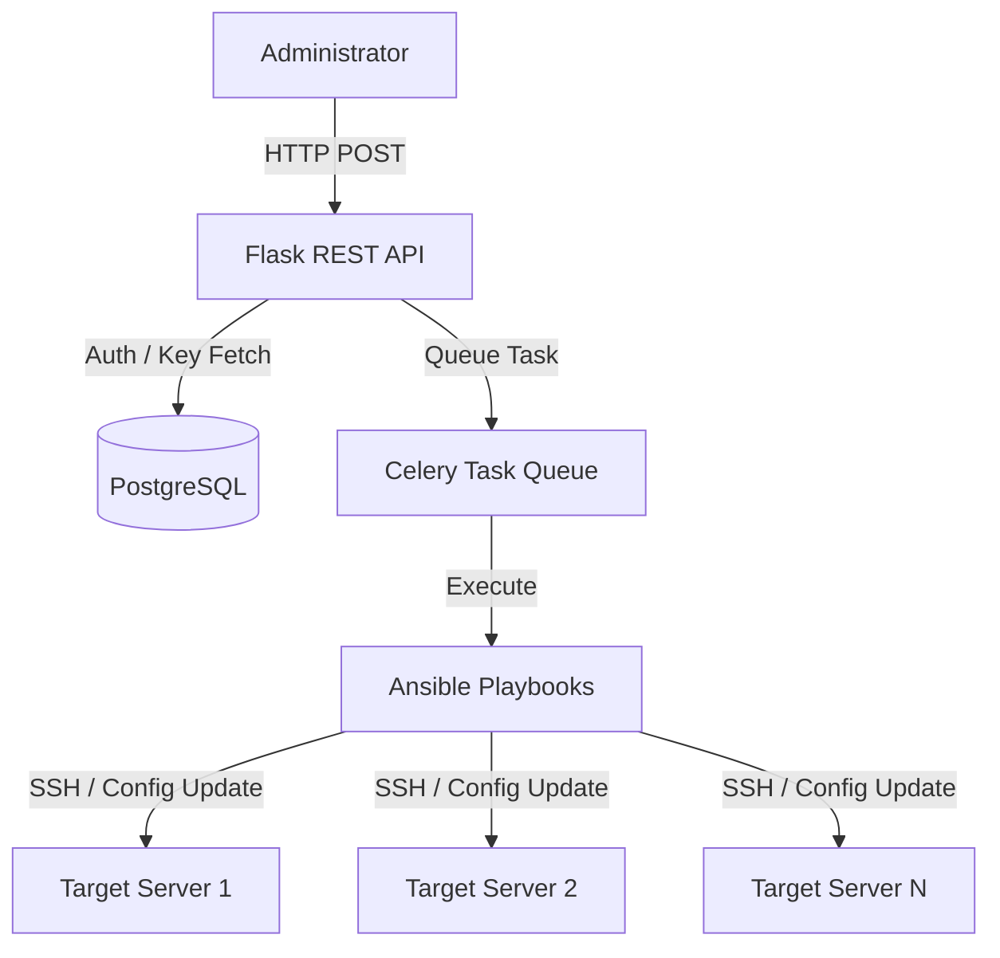

# SSH Manager

Centralized SSH access management and automated key provisioning platform for distributed infrastructure.

## Engineering Highlights

- **Centralized SSH access management** via a Flask REST API.
- **Envelope Encryption** for credential storage (AES-CBC with KEK/DEK architecture).
- **Role-based access control (RBAC)** for infrastructure provisioning.
- **PostgreSQL-backed** access state and user management via SQLAlchemy.
- **Ansible-driven multi-server provisioning** triggered asynchronously via Celery.
- **SSH CA Trust Model** configuring `TrustedUserCAKeys` across fleets.
- **Automated testing** with `pytest` and CI/linting pipeline (GitHub Actions).

## Overview

### Problem
Manual SSH key management becomes operationally expensive and error-prone as the number of users and servers grows. Administrators struggle to maintain consistent `authorized_keys` files, revoke access reliably, and audit who has access to which machines. 

### Solution
This project moves SSH credential provisioning behind an API and infrastructure automation layer. Administrators can grant or revoke access to servers centrally. The system securely encrypts private keys, manages access control lists, and uses Ansible to dynamically update SSH Certificate Authority (CA) trusts on target machines.

### Engineering Challenge
The primary challenge was securely storing access credentials without exposing plaintext private keys, while simultaneously ensuring that infrastructure updates (like modifying `sshd_config`) happen reliably across multiple distributed servers without blocking the API.

## Architecture



## Security Architecture

| Security Concern | Implementation |
|---|---|
| **Authentication** | Custom session tokens (Base64 UUIDs) with PBKDF2 password hashing. |
| **Authorization** | RBAC verified via middleware; operations like `grant_access` require `admin` boolean. |
| **Key Storage** | Database stores keys as `LargeBinary`. Plaintext private keys are never stored. |
| **Encryption** | Envelope encryption: A KEK (derived from user password) encrypts a randomly generated DEK. The DEK encrypts the SSH keys (AES-CBC). |
| **Provisioning** | Uses SSH Certificate Authority (CA) trust model (`TrustedUserCAKeys`) instead of manual `authorized_keys` management. |
| **Secrets** | Ephemeral extraction during Celery task execution; keys are scoped tightly to the Ansible runtime. |

## Provisioning Workflow

1. **Access Request**: Administrator authenticates and submits a request to grant access to target IPs.
2. **Authorization**: Flask API middleware verifies session validity and admin privileges.
3. **Decryption**: The system derives the KEK from the admin's password, decrypts the DEK, and subsequently decrypts the admin's SSH key.
4. **Queueing**: A Celery task (`grant_access`) is dispatched asynchronously.
5. **Playbook Preparation**: The Celery worker materializes the Ansible inventory, variables (`params.yml`), and temporary SSH keys.
6. **Execution**: Ansible connects to the target servers.
7. **Infrastructure Update**: The `ssh_ca.pub` file is distributed, and `/etc/ssh/sshd_config` is updated to include `TrustedUserCAKeys`.
8. **State Record**: PostgreSQL is updated to reflect the new access mapping.

## Ansible Automation

Instead of manually logging into every server to edit `authorized_keys`, the service leverages Ansible for configuration management. 

Example provisioning task (`grant.yml`):
```yaml
- name: Modify sshd_config to include ssh_ca.pub as Trusted ca key
  become: yes
  lineinfile:
    path: /etc/ssh/sshd_config
    line: "TrustedUserCAKeys /etc/ssh/{{ ca_name }}.pub"
    create: no
```
This ensures configuration state is strictly enforced and easily revocable across the fleet.

## API Documentation

| Method | Endpoint | Purpose | Auth |
|---|---|---|---|
| `POST` | `/register` | Register a new user and generate DEK/KEK secrets | None |
| `POST` | `/login` | Authenticate user and issue access token | None |
| `POST` | `/logout` | Invalidate active session | Required |
| `POST` | `/is_admin` | Check if current user has administrative rights | Required |
| `GET` | `/get_rsa_key` | Generate/retrieve RSA public key for payload encryption | None |

*(Note: ACL controllers for granting/revoking access are fully implemented in the service layer but require blueprint binding in the routing configuration).*

## Data Model

The application uses PostgreSQL with SQLAlchemy ORM.

| Entity | Stored Data | Access Pattern |
|---|---|---|
| `users` | Username, PBKDF2 hash, Admin flag, Encrypted DEK, IVs, Salts | Fast lookup for auth and secret decryption. |
| `private_keys` | AES-encrypted private keys, Key hash, User ID | Fetched during provisioning to authorize Ansible execution. |
| `public_keys` | Public keys, Key hash, User ID | Distributed to target servers as Trusted CAs. |
| `access_control` | User ID, Array of authorized IP addresses | Auditing and state management of active server access. |
| `sessions` | Active access tokens, User relation | Ephemeral access validation for API routes. |

## Operational Impact

Reported project measurements indicate significant workflow optimization:

| Metric | Before | After |
|---|---:|---:|
| Access provisioning | ~20 min | ~30 sec |
| Supported Scale | N/A | 5+ servers, 25 users |

*This reduced the manual provisioning workflow from approximately 20 minutes to approximately 30 seconds.*

## Engineering Decisions & Trade-offs

### Envelope Encryption vs Plaintext Keys
Storing SSH private keys is inherently risky. The system mitigates this by using an envelope encryption pattern. Even if the database is compromised, the private keys remain secure because the Key Encryption Key (KEK) requires the user's plaintext password, which is never stored.

### PostgreSQL vs DynamoDB
While early architectural designs considered DynamoDB (and remnants of this exist in commented code), PostgreSQL was ultimately chosen. The relational model better suits the interconnected nature of Users, Keys, Sessions, and Access Control Lists, enforcing referential integrity.

### Asynchronous Automation (Celery)
Ansible playbooks can take seconds or minutes to execute depending on fleet size. Offloading this to a Celery worker queue ensures the REST API remains fast and non-blocking.

## Development & Testing

### Prerequisites
- Python 3.8+
- PostgreSQL
- RabbitMQ (for Celery broker)

### Installation
```bash
python -m venv venv
source venv/bin/activate
pip install -r requirements.txt
```

### Running Tests
The project maintains test coverage over service layers, models, and controllers using `pytest`.
```bash
pytest
```

### CI/CD
A GitHub Actions workflow (`.github/workflows/python-app.yml`) automatically runs on push and pull requests to `master`. It enforces code quality via `flake8` and runs the full `pytest` suite.

## Known Limitations
- **Partial Routing**: While the underlying controllers (`AclController`, `KeyCreationController`) and Celery tasks are complete, some endpoints are not yet exposed in `routes.py`.
- **AWS Integration**: Dynamic EC2 inventory mapping via `boto3` is partially implemented but currently disabled.
- **Single Point of Failure**: Relies on a single RabbitMQ/Celery instance for provisioning.

## Future Roadmap
- **Short-lived SSH Certificates**: Transition from static CA keys to issuing temporary SSH certificates.
- **AWS Secrets Manager**: Offload KEK/DEK storage to a dedicated KMS.
- **Dynamic Inventory**: Re-enable `boto3` to automatically discover and target AWS EC2 instances.
- **Audit Logging**: Implement immutable audit trails for every access grant/revoke operation.
